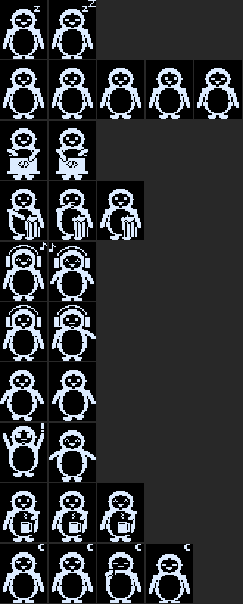

# Pingu keychain

A tiny penguin on a 0.96" OLED keychain that shows what you're doing on your Mac. When you're coding he types on a laptop, when you're watching something he eats popcorn, and he naps when the Mac sleeps. An ESP32 drives the screen. The Mac sends him your current activity over Bluetooth LE, with no cable to the laptop.



| State | When | Pingu |
|---|---|---|
| zzz | Mac asleep, lid closed, screen locked, or out of range | naps |
| meeting | FaceTime / Zoom / Discord / Teams in front, or a Brave tab on Google Meet | headset, talking |
| video | Brave on YouTube, Netflix, Twitch, etc., or QuickTime / IINA / VLC / TV in front | popcorn |
| coding | VS Code, Cursor, Xcode, Terminal, iTerm, Warp, Ghostty, or Claude in front, or Brave on claude.ai, github.com, localhost, or stackoverflow.com | typing on a laptop |
| music | Spotify / Music in front, or playing in the background | headphones |
| idle | no keyboard or mouse input for 5 min | looks around |
| chill | anything else | waddles |
| coffee | idle/chill between 06:00 and 09:59 | sips coffee |
| sleepy | idle/chill between 00:00 and 04:59 | yawns |

The states are listed in priority order: if two apply at once, the higher one wins.

## Hardware

- An **ESP32 dev board** with Bluetooth, i.e. a classic ESP32 such as an ESP32-WROOM-32 DevKit (tested on an ESP32-D0WD-V3). The ESP32-S2 has no Bluetooth.
- A **0.96" 128×64 I2C OLED, SSD1306**. The version used here has 8 pins: GND, VCC, SCL, SDA, and 4 buttons K1–K4. A plain 4-pin module also works; you just won't have the buttons.
- A **USB power bank** (or any USB power source).
- Jumper wires.

### Wiring

| OLED pin | ESP32 |
|---|---|
| VCC | 3V3 |
| GND | GND |
| SCL | GPIO22 |
| SDA | GPIO21 |
| K1 | GPIO32 |
| K2 | GPIO33 |
| K3 | GPIO25 |
| K4 | GPIO26 |

The buttons use the ESP32's internal pull-ups, and pressing a button connects the pin to GND. The screen is meant to stand **vertically** (64 wide × 128 tall).

### Buttons

| Button | Does |
|---|---|
| K1 / K2 | brightness up / down (off → dim → medium → bright) |
| K3 | show / hide the Bluetooth icon (solid when connected, blinking when not) |
| K4 | poke Pingu (also wakes the screen when it's off). **Hold 3 s** to allow a firmware update |

Brightness and the icon setting survive power-off.

## Setup

You need macOS 13 or newer (tested on macOS 27, Apple Silicon), plus:

```bash
xcode-select --install          # Swift compiler
brew install platformio         # ESP32 toolchain (or: pipx install platformio)
```

1. **Clone the repo:**
   ```bash
   git clone https://github.com/atoosz/pingu-keychain.git && cd pingu-keychain
   ```
2. **Flash the ESP32 over USB.** This is only needed the first time. After that, updates go over Bluetooth.
   ```bash
   cd firmware && pio run -t upload && cd ..
   ```
   PlatformIO downloads the pinned toolchain and libraries on the first run.
3. **Install the Mac agent.** It builds `Pingu.app` into `~/Applications` and starts it at every login.
   ```bash
   mac/install.sh
   ```
   Allow the prompts when they appear: **Bluetooth** for Pingu, then **"Pingu wants to control Brave Browser / Spotify"** the first time it checks them.
4. Unplug the ESP32 from the Mac and power it from the power bank. Within a few seconds the icon stops blinking and Pingu shows what you're doing.

To remove it: `mac/uninstall.sh`.

## Updating the firmware wirelessly

```bash
firmware/ota.sh
```

This builds the firmware, pauses the Mac agent, and waits for you. **Hold K4 for 3 s**: the screen shows "update ready", then a percentage, and Pingu reboots into the new firmware. The update takes a minute or two.

Pingu only accepts an update within 2 minutes of that button hold, so nobody nearby can flash it. The new firmware is checked before it runs, so an interrupted or corrupted transfer leaves the old one in place. If a new firmware *you wrote* crashes on boot, reflash it over USB.

## Customizing

- **Art:** edit `sprites/*.txt`. Each frame is 32×40 characters, `#` = lit pixel, drawn at 2× on the screen. The first line sets the frame time (`ms=…`). Then:
  ```bash
  python3 sprites/convert.py      # regenerates firmware/src/sprites.h and sprites/preview.png
  firmware/ota.sh
  ```
- **Which apps and sites count as what, idle time, time-of-day hours:** these are at the top of `mac/Pingu.swift`. Run `mac/install.sh` after editing.
- **Brightness levels, burn-in timings, pins:** these are constants at the top of `firmware/src/main.cpp`.

## Troubleshooting

| Problem | Fix |
|---|---|
| Garbled or shifted image | Your screen uses an SH1106 chip. In `firmware/src/main.cpp`, change `U8G2_SSD1306_128X64_NONAME_F_HW_I2C` to `U8G2_SH1106_128X64_NONAME_F_HW_I2C`. |
| Pingu upside down | Swap `U8G2_R3` ↔ `U8G2_R1` in the same line. |
| Always "zzz", icon blinking | Check `/tmp/pingu.log`. Then check System Settings → Privacy & Security → **Bluetooth**: Pingu must be allowed. |
| Brave tabs not detected | System Settings → Privacy & Security → **Automation** → Pingu → enable Brave Browser. |
| Asked for permissions again after `install.sh` | Expected. The app is ad-hoc signed, so macOS treats each rebuild as a new app. |
| Pingu dies after a while on battery | Some power banks switch off when the device draws little power. Use one with an "always on" / low-current mode. |

## How it works

- **`mac/Pingu.swift`** is a background app with no Dock icon. Every 2 s it looks at the front app, Brave's current tab URL (via AppleScript), Spotify/Music playback state, input idle time, screen lock, and display sleep. It writes one byte (the state) to the ESP32 over BLE. That write doubles as a heartbeat.
- **`firmware/src/main.cpp`** advertises as `Pingu` and draws the matching animation (U8g2, rotated to portrait). If no write arrives for 15 s, or the Mac disconnects (sleep, out of range), Pingu naps. To protect the OLED from burn-in, the image moves 1 px every 3 min, and the screen turns off after 30 min of napping.
- **Firmware updates** go through a second BLE characteristic. The Mac sends a begin message with the size, then data in 4 KB windows that the ESP32 acknowledges once they're in flash, then an end message. The ESP32 writes to the inactive app slot (`min_spiffs.csv` partitions) and only switches to it if the image verifies.

```
firmware/   PlatformIO project (ESP32, Arduino framework) + ota.sh
mac/        Swift agent, Info.plist, build/install/uninstall scripts
sprites/    editable ASCII frames, converter, preview
```

## License

[MIT](LICENSE)
